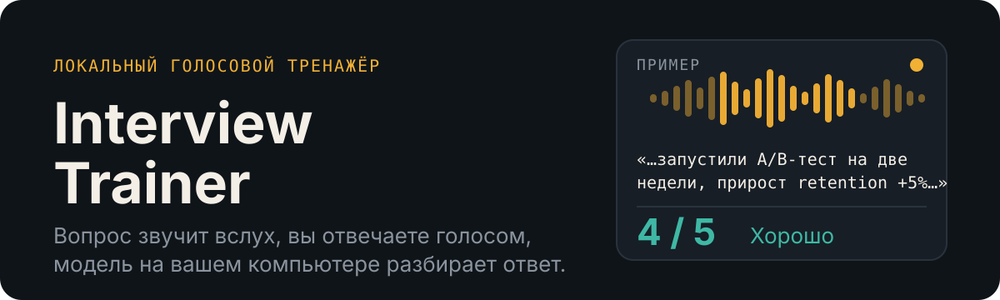
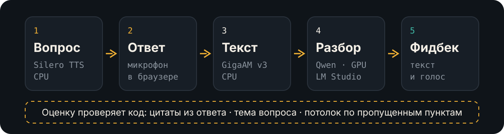

<p align="center">
  
</p>

Тренажёр для подготовки к собеседованию на русском языке. Вы загружаете вакансию, резюме и список вопросов. Приложение задаёт вопросы голосом, слушает ваши ответы, разбирает каждый и в конце даёт отчёт. Всё работает на вашем компьютере: ни резюме, ни записи голоса никуда не уходят.

## Как выглядит разбор ответа

Пример (вымышленный, не реальная запись):

> **Вопрос:** Расскажите про A/B-тест, который вы запускали.
> **Вы сказали:** «…запустили A/B-тест на две недели, посчитали прирост retention на пять процентов, проверили доли групп…»
>
> **Оценка: 4 из 5, «Хорошо».**
> Что хорошо: есть метрика, срок и вывод.
> Что поправить: не названа величина выборки.
> Как исправить: добавьте число пользователей в каждой группе.
>
> Тот же разбор модель зачитывает вслух, коротко, до 45 слов.

Оценка 4–5 значит «хорошо», 3 — «доработать», 1–2 — «переделать». Вердикт по этой шкале считает код, а не модель.

## Как это работает

<p align="center">
  
</p>

Распознавание и озвучка идут на процессоре, а видеокарта целиком отдана языковой модели. Поэтому тренажёр помещается на RTX 3060 на 12 ГБ.

**Почему модели нельзя верить на слово.** Локальная модель на 14 млрд параметров склонна придумывать замечания и завышать оценки за ответ мимо темы. Поэтому часть работы забрал код:

| Проверка | Что делает код |
|---|---|
| Ответ по теме? | Модель формулирует тему вопроса и тему ответа. Если сомнение, решает отдельный короткий запрос-арбитр. Ответ мимо вопроса получает 1 из 5 по шаблону. |
| Цитаты | Каждый засчитанный пункт должен подтверждаться цитатой из вашего ответа. Код сверяет её с расшифровкой, ненайденные цитаты не засчитываются. |
| Потолок оценки | Если не раскрыта треть ключевых пунктов, выше 3 не поставить. Если не раскрыт хотя бы один, выше 4. |
| Придирки | Хорошему ответу замечания не придумываются. Замечания про ошибки распознавания речи отбрасываются. |
| Итоговый отчёт | Цифры, статусы и динамику считает код. Модель пишет только словесный итог и рекомендации, а выдуманные ею термины отсеиваются. |

Качество разбора измеряется на наборе из 11 синтетических пар «вопрос — ответ»: `scripts\eval_review.py`.

## Возможности

- **Подготовка.** Вакансия, резюме и кейсы загружаются файлами (md, txt, docx, pdf) или вставляются текстом. Из резюме и кейсов собирается профиль кандидата, который можно поправить. Вопросы берутся из вашего файла; если рядом с вопросом есть блок «Коротко:», он становится эталонным ответом.
- **Генерация вопросов (по желанию).** Можно догенерировать вопросы по вакансии и профилю. По умолчанию выключена, вопросы берутся только из файла.
- **Собеседование.** Вопрос звучит вслух, ответ записывается в браузере (до 5 минут), расшифровка и разбор появляются сразу. Ответ можно повторить, вопрос пропустить, порядок вопросов перемешать.
- **Итоги.** Отчёт по сессии с оценками, слабыми зонами и списком «повторить» сохраняется в `report.md`. История сессий показывает динамику по каждому вопросу.
- **Тренировать слабые.** Новая сессия собирается из вопросов, на которые вы в последний раз ответили на «доработать» или «переделать».
- **Настройки.** Голос и темп озвучки, модель LM Studio, режим thinking. Применяются сразу.

## Быстрый старт

Нужны Windows 10/11, Python 3.11, [LM Studio](https://lmstudio.ai) и видеокарта NVIDIA с 12 ГБ памяти (на другом железе нужна модель поменьше, см. «Ограничения»).

**1. Установка (один раз).** В PowerShell из папки проекта:

```powershell
py -3.11 -m venv .venv
.\.venv\Scripts\python.exe -m pip install -r requirements.txt
```

Зависимости закреплены, PyTorch ставится в сборке для CPU. При первом запуске скачиваются модели распознавания (GigaAM) и озвучки (Silero). Нужен интернет только для этой первой загрузки, дальше всё работает без него.

**2. LM Studio.** Скачайте чат-модель Qwen (в проекте проверена `qwen2.5-14b-instruct-1m`, квантование Q4_K_M), загрузите её с **контекстом 8192** и максимальной выгрузкой на GPU. Включите Local Server на порту 1234 (вкладка Developer).

> Контекст 8192 важен: на 32 000 скорость упала с 22,8 до 9 токенов в секунду.

**3. Запуск.** Двойной клик по `start.bat`. Скрипт проверит окружение и LM Studio, запустит сервер, подождёт загрузки моделей (15–20 секунд) и сам откроет `http://localhost:8000`. Вручную то же самое:

```powershell
.\.venv\Scripts\python.exe -m uvicorn app.main:app --host 127.0.0.1 --port 8000
```

**4. Первая тренировка.**
1. Создайте собеседование и загрузите вакансию, резюме и файл с вопросами.
2. Нажмите «Собрать профиль» и проверьте факты, которые модель извлекла.
3. Нажмите «Извлечь вопросы», поправьте список и «Утвердить список».
4. Нажмите «Начать собеседование» и разрешите доступ к микрофону.

## Приватность

- Облачные API не используются. Модель в LM Studio не имеет выхода в интернет.
- Личные данные лежат в папке `data/`: резюме, записи, отчёты, профиль и настройки (`data/settings.json`). Папка в `.gitignore` и в репозиторий не попадает.
- Каждый запрос к модели записывается в `data/logs/llm.jsonl`, чтобы можно было разобраться, почему оценка получилась такой.

## Ограничения

- Только русский язык и только Windows.
- Модель на 14 млрд параметров иногда мягковата на пограничных ответах: может поставить «доработать» там, где честнее «переделать». Разбор одного ответа занимает около 16–19 секунд.
- Английские термины в речи GigaAM иногда искажает. Частые случаи исправляет глоссарий `glossary.yaml`, его можно дополнять своими словами.
- Профиль строится по первым 6000 символам каждого документа.
- Альтернативный движок распознавания (Whisper) отложен.

## Для разработчиков

```powershell
.\.venv\Scripts\python.exe -m pytest -q          # 303 теста, модели замоканы
pyright                                           # проверка типов
.\.venv\Scripts\python.exe scripts\eval_review.py # качество разбора, нужен LM Studio
```

Бэкенд на FastAPI, интерфейс на чистом HTML, JS и CSS без фреймворков, хранение в JSON-файлах без базы данных. Подробно:

- [ARCHITECTURE.md](ARCHITECTURE.md): устройство проекта, форматы данных, отклонения от плана
- [PLAN.md](PLAN.md): план и этапы
- [CLAUDE.md](CLAUDE.md): правила работы с проектом
- [MEMORY.md](MEMORY.md): журнал разработки
